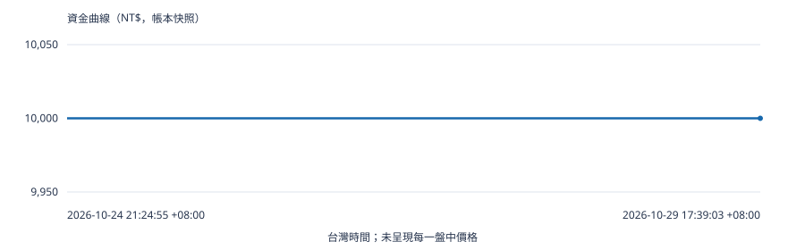

# OKX v0.9｜前瞻紙上模擬績效報告

- **帳本版本／來源 Actions：**20／40851188958
- **有效行情時間（UTC）：**2026-10-29T09:39:03.398000+00:00
- **有效行情時間（台灣）：**2026-10-29 17:39:03 +08:00
- **已平倉／未平倉／待成交：**0／0／0
- **研究本金／目前權益／費用池：**NT$10,000.00／NT$10,000.00／NT$1,000.00
- **已實現淨損益／帳本最大回撤：**NT$0.00／0.00%
- **觀察勝率／平均實現獲利虧損比：**未驗證／未驗證
- **新聞資料／實盤資格：**UNKNOWN_COVERAGE／未通過（報表不授權交易）

## 資金曲線

## 策略績效（非獨立樣本數）

| 策略 | 凍結 ID | 筆數 | 觀察勝率 | 95% Wilson 區間 | 入場計畫淨 RR 平均 | 實現獲利／虧損比 | 平均淨 R | PF | 平均獲利 NT$ | 平均虧損 NT$ | 淨損益 NT$ |
| --- | --- | --- | --- | --- | --- | --- | --- | --- | --- | --- | --- |
| 支撐阻力反轉 | SUPPORT_RESISTANCE_REVERSAL | 0 | 未驗證 | 未驗證 | 未驗證 | 未驗證 | 未驗證 | 未驗證 | 未驗證 | 未驗證 | 0.00 |
| 波動收縮突破 | VOLATILITY_CONTRACTION_BREAKOUT | 0 | 未驗證 | 未驗證 | 未驗證 | 未驗證 | 未驗證 | 未驗證 | 未驗證 | 未驗證 | 0.00 |

## 實際持倉分布

| 策略 | 平均天數 | 中位數 | P90 | P95 | 最長 | 1～3 天比例 | 超過 14 天筆數 |
| --- | --- | --- | --- | --- | --- | --- | --- |
| 支撐阻力反轉 | 未驗證 | 未驗證 | 未驗證 | 未驗證 | 未驗證 | 未驗證 | 0 |
| 波動收縮突破 | 未驗證 | 未驗證 | 未驗證 | 未驗證 | 未驗證 | 未驗證 | 0 |

## 逐筆已平倉交易

目前沒有資料。

## 逐筆入場成交

目前沒有資料。

## 逐筆止盈／止損與其他出場

目前沒有資料。

## 未平倉部位

目前沒有資料。

## 待成交候選

目前沒有資料。

## 候選拒絕原因（可同時多項）

| 原始原因代碼 | 候選筆數 |
| --- | --- |
| CROSS_NOT_VERIFIED | 13 |
| LIQUIDITY | 7 |
| NET_RR_BELOW_3 | 8 |
| NEWS_UNKNOWN_NOT_NO_EVENT | 13 |
| PARTICIPATION | 2 |
| STRUCTURE_INVALID | 3 |
| WIN_RATE_NOT_VERIFIED | 13 |

## 累計帳本版本事件

| 事件序號 | 事件類型 | 來源鍵／Run ID | 時間（台灣） | 相同輸入重播 |
| --- | --- | --- | --- | --- |
| 1 | INITIALIZE | genesis | 2026-10-24 21:24:55 +08:00 | 不適用 |
| 2 | RUN_COMPLETE | 40098344209 | 2026-10-24 21:30:11 +08:00 | False |
| 3 | RUN_COMPLETE | 40098537490 | 2026-10-24 21:32:26 +08:00 | True |
| 94 | RUN_COMPLETE | 40109133784 | 2026-10-24 23:55:45 +08:00 | False |
| 95 | RUN_COMPLETE | 40109254482 | 2026-10-24 23:56:57 +08:00 | True |
| 247 | RUN_COMPLETE | 40121713808 | 2026-10-25 02:40:28 +08:00 | False |
| 398 | RUN_COMPLETE | 40134269921 | 2026-10-25 05:27:51 +08:00 | False |
| 580 | RUN_COMPLETE | 40145357416 | 2026-10-25 08:06:38 +08:00 | False |
| 791 | RUN_COMPLETE | 40166887754 | 2026-10-25 13:49:54 +08:00 | False |
| 1032 | RUN_COMPLETE | 40186980907 | 2026-10-25 19:00:16 +08:00 | False |
| 1183 | RUN_COMPLETE | 40204526237 | 2026-10-25 22:56:39 +08:00 | False |
| 1368 | RUN_COMPLETE | 40220568991 | 2026-10-26 02:18:51 +08:00 | False |
| 1520 | RUN_COMPLETE | 40235980078 | 2026-10-26 05:33:18 +08:00 | False |
| 1611 | RUN_COMPLETE | 40247022530 | 2026-10-26 07:58:00 +08:00 | False |
| 1612 | CONTRACT_SPEC_REVIEW_APPLIED | BCH-TICK-20261028-v1 | 2026-10-28 23:31:27 +08:00 | 不適用 |
| 4196 | RUN_COMPLETE | 40716643601 | 2026-10-28 23:31:27 +08:00 | False |
| 4197 | RUN_COMPLETE | 40717008800 | 2026-10-28 23:33:05 +08:00 | True |
| 4348 | RUN_COMPLETE | 40741973663 | 2026-10-29 02:07:41 +08:00 | False |
| 4559 | RUN_COMPLETE | 40784106768 | 2026-10-29 07:00:33 +08:00 | False |
| 4743 | RUN_COMPLETE | 40805798260 | 2026-10-29 10:21:48 +08:00 | False |
| 5074 | RUN_COMPLETE | 40851188958 | 2026-10-29 17:39:03 +08:00 | False |

## 完整性與版本紀錄

| 項目 | 值 |
| --- | --- |
| 報表版本 | 0.9.7-reporting.1 |
| 報表程式指紋 | 00b527de02e31f2c105124f579e82f1a0f4447af6e286e91bbe76a8867215350 |
| 來源 Artifact ID | 12886458799 |
| 完整 ZIP SHA-256 | f0892dd6befc4ae1574a263f8a9624aa9856d64947449d9ff1c1dc13b62830d3 |
| 狀態 SHA-256 | 5892e24c605cf08a5d19633e05a99b05aa2b298b11de5f4a0dcf71ca47faa11a |
| 策略／風控 config hash | 4e85ee42786c656414f4a038093fcb12ce2516bdb1f5e6cdbe6b3752b578c5fa |
| 凍結程式 SHA | e8863f819f29ef0cf2806ea06157aae7ac3a633e |
| 排程 commit | f4ff35a088282a37264b82108e32f6c2e31dc28c |
| 規格操作 payload SHA | f2f56aed416d540a71156dd58f5bc9a28a6a0baf |
| 直接 parent Artifact 核對 | 已核對 |
| 原始根節點 | 40097744951 |
| 原研究開始（台灣） | 2026-10-24 21:24:55 +08:00 |
| 資料超過正式引擎新鮮度門檻 | 否；仍不構成正式恢復授權 |

## 資料品質與限制

- 零交易或缺少獲利／虧損樣本時，勝率、PF、盈虧比及持倉統計顯示未驗證，不產生示範成交。
- 入場計畫淨 RR、歷史平均實現獲利／虧損比、逐筆淨 R 與 PF 是不同量，不能互相替代。計畫值照原帳本記錄，不重新最佳化。
- 觀察勝率及信賴區間不代表單筆真實成功機率；相對獨立及有效樣本數尚未驗證。報表不判定策略合格，也不調整 60%／淨 RR≥3 門檻。
- 滑價已反映於模擬成交價，不再重複扣除；手續費、資金費及固定匯率均為凍結研究模型，不代表真實 OKX 成交或費率。
- 資金曲線來自帳本快照，不能代表完整盤中尾部風險。計畫停損預算不是全倉實際虧損保證上限。
- 一般新聞不產生勝率加成；UNKNOWN_COVERAGE 不是沒有重大事件。策略與全倉實盤資格維持未通過。
- 報表是離線唯讀輸出，不執行策略、不恢復正式帳本、不傳送通知、不下單。原 7 天等正式停機規則沒有修改。
- SHA-256 針對提供的 GitHub 來源元資料驗證位元完整性，不是 GitHub 數位簽章；來源元資料仍需由可信 API／封存紀錄取得。
- Artifact 保留 90 天不是永久備份。外部備份傳輸未實作、未啟用；儲存目的地待使用者確認。
